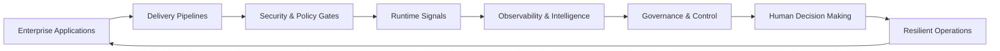

</div>

<br/>

<div align="center">


</div>

<br/>

<div align="center">


</div>

---

# Enterprise Engineering & Architecture Leader

I design and lead enterprise platforms that connect software delivery, cloud infrastructure, security, reliability, and AI-assisted decision-making into a single operating model.

My work spans cloud engineering, DevSecOps, SRE, and applied AI with a focus on practical architecture, disciplined governance, and trusted operations at scale.

<div align="center">

### AI assists. Engineers decide.

</div>

---

## ✦ Product Lens: Enterprise Operating Intelligence



From code to cloud to operations, I focus on turning delivery and runtime signals into governable, resilient engineering decisions.

<div align="center">

<table>
  <tr>
    <td align="center"><strong>10+ Years</strong><br/>Platform strategy<br/>and execution</td>
    <td align="center"><strong>100+ Pipelines</strong><br/>Built and evolved</td>
    <td align="center"><strong>Secure by Default</strong><br/>DevSecOps built in</td>
    <td align="center"><strong>Human-led AI</strong><br/>Evidence before automation</td>
  </tr>
</table>

</div>

---

## ✦ Enterprise Operating Model

```text
Infrastructure → Signals → Intelligence → Governance → Human Control
```

<div align="center">

<table>
  <tr>
    <td align="center"><strong>SOFTWARE</strong><br/>Enterprise apps<br/>and integrations</td>
    <td align="center">→</td>
    <td align="center"><strong>PLATFORMS</strong><br/>Delivery paths<br/>and runtime support</td>
    <td align="center">→</td>
    <td align="center"><strong>INTELLIGENCE</strong><br/>Operational insight<br/>from signals</td>
  </tr>
  <tr>
    <td align="center"><strong>GOVERNANCE</strong><br/>Policy, control<br/>and traceability</td>
    <td align="center">→</td>
    <td align="center"><strong>RELIABILITY</strong><br/>Resilient operations<br/>and trust</td>
    <td align="center">→</td>
    <td align="center"><strong>HUMAN CONTROL</strong><br/>Engineers guide<br/>the system</td>
  </tr>
</table>

</div>

---

## 🧠 Core Capability Areas

| Area | Focus |
|---|---|
| **Software Engineering & Integration** | Java, Spring Boot, REST APIs, SQL, enterprise application integration |
| **Lifecycle Automation & Governance** | Delivery pipelines, release controls, change accountability, and reduced drift |
| **Secure Lifecycle Governance** | Security embedded into SDLC, compliance, vulnerability handling, and supply-chain traceability |
| **Cloud Infrastructure Architecture** | Platform design, infrastructure automation, and recovery planning |
| **SRE & Operational Reliability** | Incident support, telemetry review, release checks, and developer enablement |
| **Applied AI & LLMOps** | Python automation, grounded troubleshooting, evidence-based workflows, and human review |

---

## ⚙️ Featured Work

| Workstream | What it delivers |
|---|---|
| **Enterprise Software Delivery & DevSecOps Platform** | Reusable delivery paths, artifact controls, security gates, and release accountability |
| **Platform Lifecycle & Upgrade Engineering** | Compatibility checks, staged changes, rollback preparation, and controlled production execution |
| **Cloud-Native & Enterprise Application Engineering** | Application development, integration, delivery automation, and runtime operability |

### Strategic engineering focus

- Delivery pipelines that reduce drift and improve trust in every change
- Platform modernization with governed, auditable execution
- Reliable cloud operations built for scale, recovery, and observability
- AI-assisted operations grounded in evidence, context, and human review

---

## 🧩 Why this matters

- Improve release confidence without slowing engineering teams down
- Encode governance into delivery paths instead of relying on manual control
- Reduce drift and increase traceability across the lifecycle
- Turn operational telemetry into trusted decision support
- Use AI to assist engineering judgment without replacing accountability

### Operating principles

- Design for operational clarity, not just delivery velocity
- Build trust through evidence, auditability, and repeatable controls
- Treat platform modernization as both a governance and reliability challenge
- Keep humans accountable in the loop where decisions carry risk and consequence

---

## 🧬 Modern Tech Stack

| Layer | Stack |
|---|---|
| **Application Engineering** | Java, Spring Boot, REST APIs, SQL, integration patterns, enterprise service design |
| **Cloud & Platforms** | AWS, Azure, GCP, Kubernetes, OpenShift, Docker, Terraform, Ansible, platform automation |
| **Delivery & DevSecOps** | CI/CD, GitHub Actions, GitLab CI, Jenkins, Bamboo, Artifactory, SonarQube, SAST, DAST, SBOM, policy gates |
| **Observability & Reliability** | Prometheus, Grafana, Dynatrace, Splunk, ELK, health checks, incident follow-through, runbook-driven ops |
| **AI & Automation** | Python, LLMOps, grounded diagnostics, workflow automation, prompt-driven engineering assistance |
| **Governance & Control** | Lifecycle governance, compliance review, release accountability, auditability, secure change paths |

---

## 🚀 Current Focus

- Enterprise platform modernization with lifecycle-aware governance
- Secure, traceable delivery pipelines for production-critical systems
- Cloud-native runtime reliability and operational readiness
- AI-assisted engineering workflows grounded in evidence, context, and human review
- Architecture that balances speed, resilience, and accountable control

---

## 📌 Portfolio System

<div align="center">

<a href="https://raghuramreddy.tech">

</a>

<a href="https://raghuramreddy.tech/pages/work.html">

</a>

<a href="https://raghuramreddy.tech/pages/blog.html">

</a>

<a href="https://raghuramreddy.tech/pages/tokenops.html">

</a>

</div>

---

## 🌐 Digital Presence

<div align="center">

<a href="https://raghuramreddy.tech">

</a>

<a href="https://linkedin.com/in/raghuramreddy-t">

</a>

<a href="https://github.com/Raghuramreddy-t">

</a>

</div>

---

<div align="center">

## RRR

### Raghuramreddy

### Designing technology for human experience


</div>

<div align="center">


</div>

