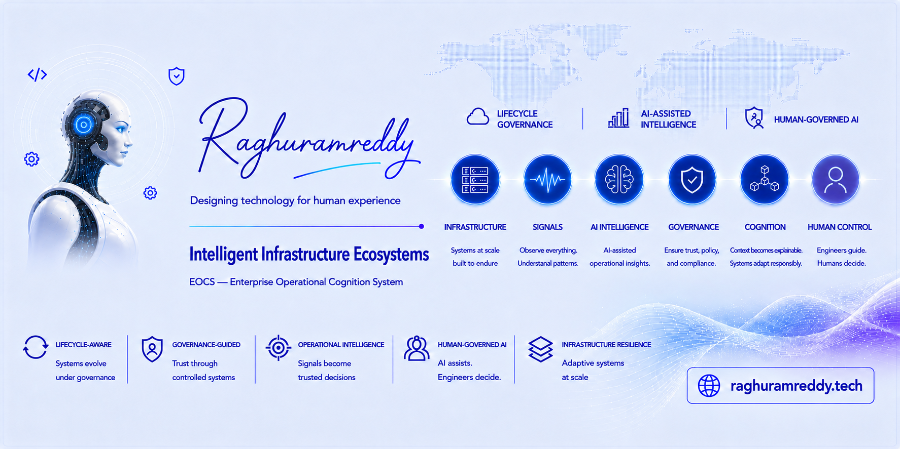
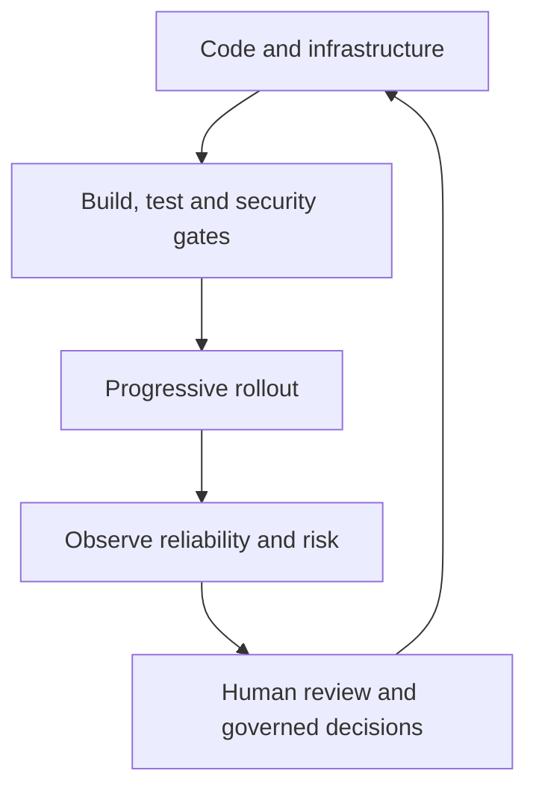



# Raghuramreddy Thummalapalli

**Intelligent Infrastructure Ecosystems Architect**

Software delivery · Cloud platforms · DevSecOps · Reliability · Applied AI

[Portfolio](https://raghuramreddy.tech) · [Work & Impact](https://raghuramreddy.tech/work/) · [TokenOps Lab](https://raghuramreddy.tech/labs/tokenops/) · [LinkedIn](https://linkedin.com/in/raghuramreddy-t)

I design and lead enterprise platforms that connect application engineering, cloud infrastructure, security, and operations. My focus is practical: make changes repeatable, make systems observable, and keep engineering decisions accountable.

## Explore my work

### TokenOps — AI cost engineering lab

An interactive lab for exploring model economics: compare models, estimate prompt costs from approximate token counts, and forecast budgets from request volume and input/output assumptions.

**Workflow:** Compare models → estimate a request → explore a monthly budget.

[Open TokenOps →](https://raghuramreddy.tech/labs/tokenops/) · [Browse the portfolio source](https://github.com/Raghuramreddy-t/raghuramreddy-updated)

### Upgrade Factory — enterprise case study

**Problem:** Platform upgrades need compatibility checks, controlled rollout, and a dependable recovery path.

**Approach:** GitOps and Helm orchestration, preflight policy checks, canary stages, health gates, and version-pinned rollback.

**Reported case-study outcome:** Upgrade duration reduced from 8 hours to 45 minutes, with compliance evidence and rollback readiness preserved.

[Read the case study and architecture decisions →](https://raghuramreddy.tech/work/)

### Governed delivery — from code to production

Reusable delivery paths connect build, test, security, deployment, and runtime observation. Artifact controls and policy gates make releases traceable; operational signals guide the next change.

[Explore the delivery blueprint →](https://raghuramreddy.tech/work/)

### Platform foundations — designed for adoption

Cloud-native architecture brings compute, identity, networking, delivery, and observability together with clear ownership. Golden paths and infrastructure automation help teams use those foundations consistently.

[Explore platform architecture →](https://raghuramreddy.tech/work/)

## Signature frameworks

Architecture models I develop to connect infrastructure, operational evidence, and accountable decisions.

| Framework | Purpose |
|---|---|
| **EOCS — Enterprise Operational Cognition System** | Connect delivery, runtime, security, and governance signals to operational decisions. |
| **Unified XOps** | Bring platform operations, DevSecOps, AIOps, GitOps, and SRE into a shared operating model. |
| **19-Block Ecosystem Architecture** | Map relationships between software, runtimes, infrastructure, governance, and human experience. |

[Explore the frameworks on my portfolio →](https://raghuramreddy.tech/)

## How I build

- **Make the safe path repeatable:** Encode policy and release controls into delivery workflows.
- **Plan recovery early:** Include compatibility checks, staged rollout, and rollback in modernization work.
- **Use runtime evidence:** Let telemetry and incident learning inform engineering priorities.
- **Keep AI accountable:** Ground assistance in context and evidence, with human review for consequential decisions.

## Engineering toolkit

| Area | Technologies and practices |
|---|---|
| **Applications** | Java, Spring Boot, REST APIs, SQL, enterprise integration |
| **Cloud & platforms** | AWS, Azure, GCP, Kubernetes, OpenShift, Docker |
| **Infrastructure automation** | Terraform, Ansible, Helm, GitOps |
| **Delivery & security** | GitHub Actions, GitLab CI, Jenkins, Bamboo, Artifactory, SonarQube, SAST/DAST, SBOM |
| **Observability** | Prometheus, Grafana, Dynatrace, Splunk, ELK, runbooks |
| **AI & automation** | Python, LLMOps, grounded diagnostics, workflow automation |

## Current focus

- Enterprise platform modernization with lifecycle governance.
- Secure delivery and operational readiness for production-critical systems.
- AI-assisted engineering workflows grounded in evidence and human judgment.

## Writing & open source

- [Grounded AI Systems](https://raghuramreddy.tech/blog/rag-knowledge-systems/) — an article and compact lab comparing RAG, MCP, agents, and coordinated search.
- [Applied AI Systems](https://raghuramreddy.tech/applied-ai-systems/) — operational signals, constrained reasoning, and recommendations reviewed by engineers.
- [Portfolio source](https://github.com/Raghuramreddy-t/raghuramreddy-updated) — HTML, CSS, vanilla JavaScript, and JSON on GitHub Pages, with validation scripts for links, sitemap, and encoding.

## Connect

Explore my [portfolio](https://raghuramreddy.tech), review [selected work](https://raghuramreddy.tech/work/), or connect on [LinkedIn](https://linkedin.com/in/raghuramreddy-t).

**AI assists. Engineers decide.**

Designing technology for human experience.

